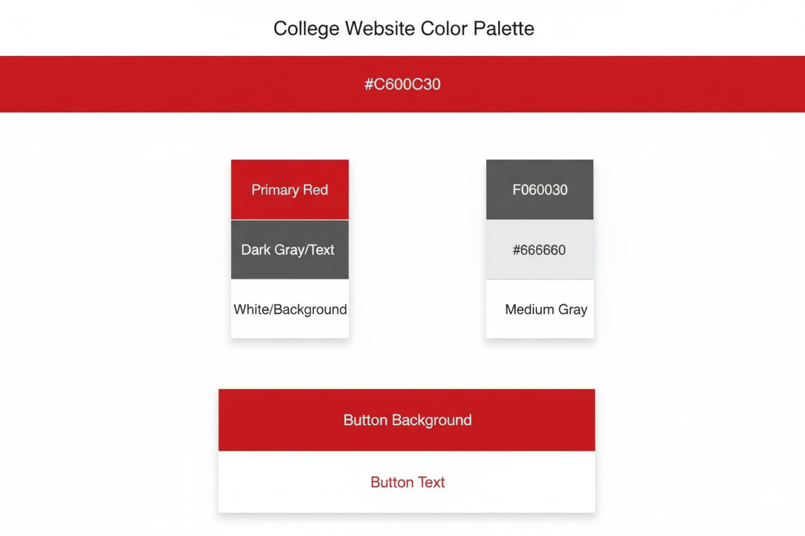

# College Website Color Palette

Based on the provided screenshots, here is a suggested color palette:

## Primary Colors

*   **Red:** `#C60C30` (Used for the main banner, active links, and prominent headings)
*   **White:** `#FFFFFF` (Used for background, text on red backgrounds, and navigation items)
*   **Dark Gray/Black:** `#333333` (Used for main text, icons, and some navigation elements)

## Secondary/Accent Colors

*   **Lighter Gray:** `#F0F0F0` (Used for backgrounds of sections, borders, or subtle distinctions)
*   **Medium Gray:** `#666666` (Used for secondary text, hover states, or less prominent information)

## Example Usage

*   **Main Banner Background:** `#C60C30`
*   **Main Text Color:** `#333333`
*   **Navigation Links (Default):** `#333333`
*   **Navigation Links (Hover/Active):** `#C60C30`
*   **Background Sections:** `#FFFFFF` or `#F0F0F0`
*   **Button Background:** `#C60C30`
*   **Button Text:** `#FFFFFF`

## Image to illustrate the palette

